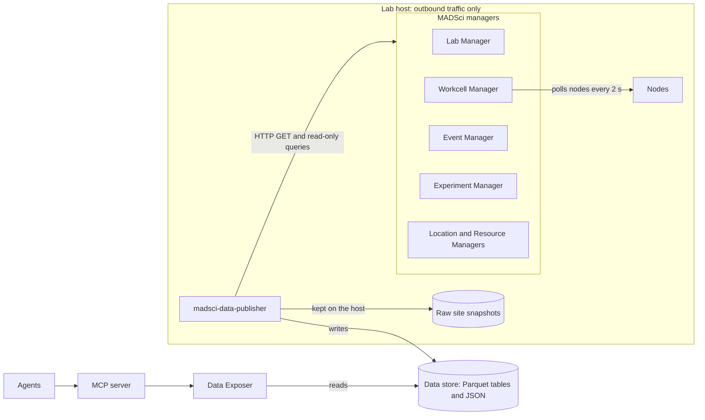
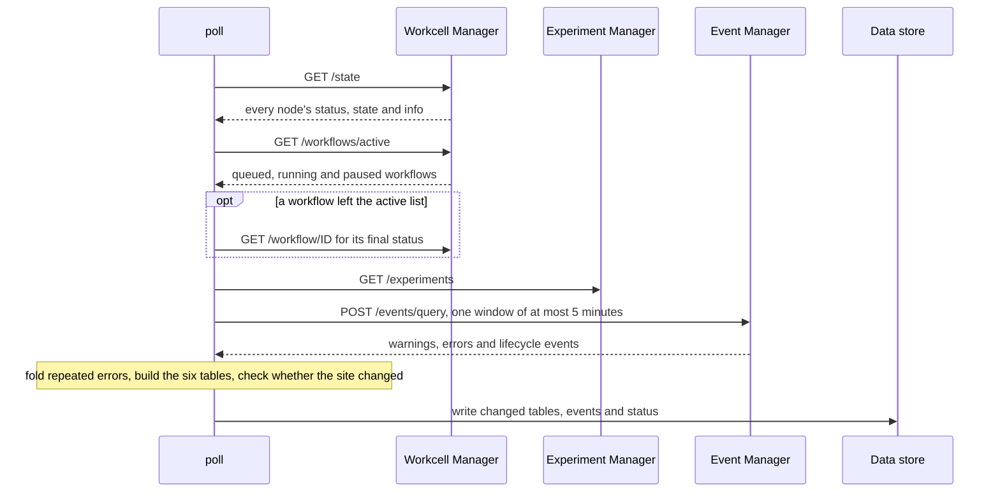

# MADSci Data Publisher

A read-only client that runs next to a [MADSci](https://github.com/AD-SDL/MADSci) lab and publishes what the lab is doing to a data store, so agents and remote users can follow it without reaching into the lab.

It reads the MADSci managers' HTTP APIs and never connects to a database. It has two tools:

- **Live data**, polled every 30 seconds: node status, active workflows and their current steps, experiments, and selected events such as errors, step failures and experiment changes.
- **Site description**, collected on request: the nodes in a workcell, their actions and arguments, named locations, transfer paths and resource templates. Run it before an experiment, or when the publisher reports that the site changed.

The data store is a directory of Parquet files in the layout the MCP layer's Data Exposer reads (the `dummy-data` service in the madsci-mcp project), so the MCP server can query a real lab with no changes.

## How it works

The publisher runs on the lab host and only sends data out. Agents read the data store, never the lab.



**Live data.** Every 30 seconds `poll()` makes about four requests. It reads node status from the Workcell Manager rather than from the nodes, because the workcell already polls each node every 2 seconds. It turns what it read into the MCP tables and writes only the tables that changed.



**Site description.** `describe_site()` reads the workcell's `/state` (which holds every node's actions and arguments), the location list, the transfer graph and the resource templates. That is four requests, and no node is contacted directly. It publishes a summary without robot poses or node configuration, and keeps the raw responses on the lab host. It also stores a fingerprint of the nodes and their actions; when a later poll sees a different fingerprint, the status file says the site description is stale.

**The code** is eight files:

| File | What it does |
|---|---|
| `publisher.py` | `LabPublisher` with `poll()`, `run()` and `describe_site()`, and the command line |
| `lab.py` | Every HTTP request (GET, plus POST only to read-only query routes), finding the managers through the Lab Manager, and ULID time helpers |
| `events.py` | The targeted event query, the cursor that reads each event once, and folding of repeated errors |
| `tables.py` | Turns MADSci records into the six MCP tables |
| `site.py` | Builds the site description and the site fingerprint |
| `store.py` | Writes tables and JSON files atomically, and strips credentials from everything it writes |

## Quick start

Start the [MADSci example lab](https://github.com/AD-SDL/MADSci/tree/main/examples/example_lab), then:

```bash
pip install -e '.[parquet]'
madsci-data-publisher --out data site          # site description, on request
madsci-data-publisher --out data run           # live data every 30 s (Ctrl+C to stop)
madsci-data-publisher --out data run --once    # one poll
```

From Python, which is how an agent would call it:

```python
from madsci_data_publisher import DataStore, LabPublisher

pub = LabPublisher(DataStore("data"), lab_url="http://localhost:8000/")
summary = pub.describe_site()   # writes data/site_description.json
status = pub.poll()             # writes the tables once; status["site"]["stale"] says if the site changed
pub.run()                       # keeps polling every 30 s
```

To let the MCP server read it, point the Data Exposer at the same directory:

```bash
cd madsci-mcp/dummy-data
DATA_EXPOSER_DATA_DIR=/path/to/data uv run uvicorn app.main:app --port 8090 \
    --reload --reload-dir /path/to/data --reload-include '*.parquet'
```

The Data Exposer loads its tables once at startup, so `--reload` restarts it when the publisher writes a change.

## What it writes

| File | Contents |
|---|---|
| `labs`, `workcells`, `nodes`, `campaigns`, `experiments`, `workflows` (`.parquet`) | The MCP layer's six tables, built from the lab's live state |
| `events.parquet` | Warnings, errors and lifecycle events, newest first, with repeats folded into one row with a count |
| `site_description.json` | The last site description |
| `publisher_status.json` | Time of the last poll, which sources answered, and whether the site changed since the last description |

The raw site snapshot holds node configuration, device addresses and robot poses, so it stays on the lab host under `~/.local/state/madsci-data-publisher/snapshots/` and is never written to the data store.

## Configuration

One setting is enough: the Lab Manager URL (`--lab-url` or `LAB_SERVER_URL`, default `http://localhost:8000/`). Its `/context` lists every other manager. Without a Lab Manager, set `WORKCELL_SERVER_URL`, `EVENT_SERVER_URL` and `EXPERIMENT_SERVER_URL`.

## MADSci behaviors it works around

- Most events are stored with a generic type such as `log_error`, with the real type in `event_data`. The event query checks both.
- The events query route has no result limit, and a large query stops the Event Manager from storing new events while it runs. Every query is bounded by event ID and covers at most 5 minutes.
- Event timestamps are local times from whichever process sent them. Event IDs are ULIDs whose time part is reliable, so the publisher uses IDs for ordering and time.
- The Experiment Manager records `completed` even when an experiment application reports a failure. The publisher prefers the application's `experiment_failed` and `experiment_cancelled` events.
- MADSci has no campaign service. Experiments and workflows without a campaign point at a placeholder campaign named `unassigned`, because the MCP schema requires one.

The only POST requests the code can send are read-only queries (`/events/query`, `/resource/query`, `/history/query`). Credentials are stripped from everything before it is written.

## Status

Early development, started at the RPL Agentic Hackathon at Argonne in November 2026. Tested against the MADSci example lab (0.8.0). Interfaces will change.

## License

MIT. See [LICENSE](LICENSE).
